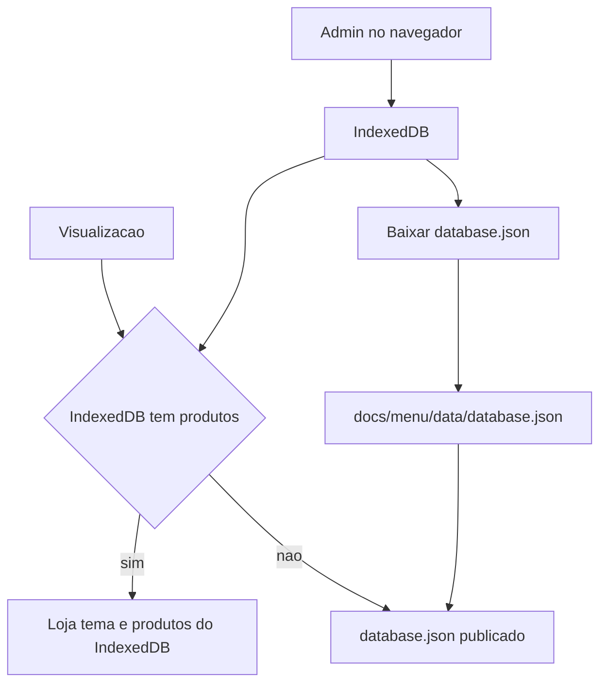

# PRD — Cardápio digital

Sistema estático em `docs/menu` para uma loja publicar o cardápio no GitHub Pages. A administração grava no IndexedDB do navegador de quem configura a loja. Nesse aparelho, a visualização usa essa base quando há produtos. Nos demais, lê o JSON versionado no repositório.

## Objetivo

O cliente abre o cardápio, vê a marca, os produtos visíveis, o endereço e fala com a loja pelo WhatsApp. O dono mantém as lojas e os produtos, escolhe o tema, importa uma planilha e publica o arquivo que o site passa a servir.

## Usuários

- **Cliente.** Abre a visualização em qualquer aparelho e consulta o cardápio publicado.
- **Dono.** Usa a administração no próprio navegador para criar, consultar, editar e excluir lojas e produtos, escolher o tema e gerar o arquivo de publicação.

## Arquitetura

O IndexedDB fica no navegador que fez o cadastro. Outro celular ou computador não enxerga essa base. A tela pública, rota padrão em `docs/menu/index.html`, escolhe a origem dos dados neste navegador:

- Com ao menos um produto no IndexedDB, a visualização mostra a loja em uso, o tema e os produtos visíveis dessa base. Este é o aparelho que faz a administração, e a tela acompanha a edição local no lugar de `database.json`.
- Sem produtos no IndexedDB, a visualização lê `docs/menu/data/database.json`.

A administração (`docs/menu/admin.html`) cria, lista, edita e exclui lojas e produtos, e grava o tema no IndexedDB. A publicação usa a loja marcada como em uso. O botão **Publicar** monta o JSON com a logomarca em base64 e inicia o download de `database.json`. O dono substitui `docs/menu/data/database.json` e envia o arquivo ao repositório. O GitHub Pages passa a servir essa versão nos aparelhos que não têm produtos locais.



### Arquivos previstos

- `docs/menu/index.html` — visualização pública, página padrão.
- `docs/menu/admin.html` — CRUD da loja, CRUD de produtos, importação, tema e publicação.
- `docs/menu/data/database.json` — snapshot publicado.
- CSS de tema aplicado sobre o mesmo HTML da visualização.
- Scripts da administração, do IndexedDB, da importação CSV, da publicação, da visualização e do WhatsApp.

## Fora de escopo

- Login e senha.
- Pedido, carrinho e pagamento.
- Várias lojas ao mesmo tempo na visualização. O cardápio mostra uma loja, a que está em uso.
- Foto de produto.
- Escrita automática no GitHub a partir do navegador.

## Áreas

| Área | Arquivo | Papel |
| --- | --- | --- |
| Visualização | `docs/menu/index.html` | Página padrão. Com produtos no IndexedDB deste aparelho, lê essa base. Sem produtos locais, lê o JSON publicado. |
| Administração | `docs/menu/admin.html` | CRUD de loja e de produto, tema, CSV e publicação. Lê e grava o IndexedDB. |

As duas telas funcionam em celular, tablet e desktop. No celular, formulários e listas empilham em uma coluna. A navegação por categoria da visualização permanece acessível durante a rolagem. O botão de WhatsApp fica fixo e deixa o rodapé legível.

## Loja

A administração lista, cria, edita e exclui lojas no IndexedDB. Cada loja é um registro próprio. Uma delas fica marcada como em uso. A visualização local e o `database.json` usam só essa loja.

A primeira loja criada já nasce em uso. Marcar outra como em uso tira a marca da anterior. Excluir a loja em uso passa a marca para a próxima da lista. Sem lojas, a visualização omite logomarca, horário, endereço e WhatsApp.

| Campo | Regra |
| --- | --- |
| Identificador | Gerado na criação. |
| Nome | Texto obrigatório na publicação. |
| Logomarca | Imagem enviada pelo dono. Na publicação entra em base64 dentro do JSON. |
| Horário | Hora de abertura e hora de fechamento, no mesmo intervalo para os dias marcados. |
| Dias da semana | Seleção de segunda a domingo. |
| Telefone | Dígitos com código do país, usado no WhatsApp. |
| Endereço | Texto exibido no rodapé. |
| Link do Maps | URL aberta a partir do endereço no rodapé. |
| Em uso | Uma loja por vez. Define qual registro entra na visualização e na publicação. |

## Produto

| Campo | Regra |
| --- | --- |
| Identificador | Gerado na criação. |
| Nome | Texto obrigatório. |
| Descrição | Texto livre. |
| Preço | Valor em real, exibido em BRL. |
| Visível | Liga ou desliga a presença no cardápio publicado. |
| Categoria | Uma entre `salgados`, `doces`, `bebidas` e `almoços`. |

A administração lista, cria, edita e exclui produtos. A visualização agrupa por categoria, na ordem salgados, doces, bebidas e almoços. Categoria sem item visível não aparece. Itens com visibilidade desligada permanecem na administração e ficam de fora do JSON e da tela, tanto na leitura local quanto na publicada.

## Importação CSV

A administração aceita um arquivo CSV de produtos. A importação grava no IndexedDB e deixa o JSON publicado como está até o próximo **Publicar**.

Colunas, com cabeçalho obrigatório:

- `nome`
- `descricao`
- `preco`
- `visivel`
- `categoria`

O separador preferido é `;`, como no Excel em português. Vírgula também é aceita quando o arquivo inteiro usa esse separador. `visivel` aceita `sim`, `nao`, `não`, `true`, `false`, `1` e `0`. `categoria` precisa ser um dos quatro valores fixos. `preco` aceita `12.50` e `12,50`.

Produto já existente com o mesmo nome, sem diferenciar maiúsculas, é atualizado. Nome novo é incluído. Linha inválida entra numa lista de erros com o número da linha e o motivo. As linhas válidas do mesmo arquivo são gravadas mesmo quando outras falham.

## Temas

O dono escolhe um tema na administração. O identificador vai no JSON publicado. A visualização aplica o tema só com CSS, sobre a mesma estrutura de página.

| Identificador | Nome | Referência | Aparência |
| --- | --- | --- | --- |
| `claro` | Claro editorial | [Café Minimal](https://restaurant-demo.integrauth.com/) e [Royale](https://menuhoster.com/templates) | Fundo creme, tipografia serifada, nome e preço na mesma linha, bastante espaço em branco. |
| `escuro` | Escuro | Obsidian e Black, em [MenuHoster](https://menuhoster.com/templates) | Fundo carvão, acento dourado, preço em destaque. |
| `rustico` | Rústico | Terra, em [MenuHoster](https://menuhoster.com/templates), e [Rustico](https://fizzyapple.co.uk/recent-work/rustico-restaurant-website-design/) | Fundo de papel, serifada, tons de terra. |
| `vibrante` | Vibrante | Lumen, em [MenuHoster](https://menuhoster.com/templates) | Cards em grade e uma cor por categoria. |

Tema ausente ou desconhecido na visualização cai em `claro`.

## WhatsApp

O botão usa o telefone da loja em uso na mesma origem do cardápio: o IndexedDB, quando este aparelho tem produtos locais, ou o telefone publicado no JSON, nos demais. O texto inicial da conversa é `Olá, vim pelo cardápio.`

- No computador, o link é `https://web.whatsapp.com/send?phone=` seguido do telefone em dígitos e do texto.
- No celular, o link é `https://wa.me/` seguido do telefone em dígitos, com o texto na query.

A detecção trata como celular os agentes de Android, iPhone e iPad. Sem telefone na origem escolhida, o botão não é exibido.

## Visualização pública

No aparelho da administração, produtos gravados no IndexedDB mandam na tela. Havendo ao menos um produto nessa base, a página ignora `database.json` e mostra a loja em uso, o tema e os produtos visíveis do IndexedDB. A edição local aparece na visualização deste navegador antes da publicação.

Sem produtos no IndexedDB, a página lê o JSON publicado e mostra:

- logomarca e nome da loja;
- horário e dias de funcionamento;
- produtos visíveis, agrupados por categoria, no tema da origem escolhida;
- no rodapé, o endereço e o link do Maps;
- o botão de WhatsApp, quando há telefone.

Os mesmos blocos aparecem quando a origem é o IndexedDB.

Quando não há produtos locais e `database.json` ainda não existe ou não pode ser lido, a página informa que o cardápio ainda não foi publicado e omite lista, rodapé de endereço e botão de WhatsApp.

## Administração

A tela reúne, em seções empilháveis no celular:

- lista e formulário da loja, para criar, editar, excluir e marcar qual está em uso;
- lista e formulário de produtos;
- importação CSV, com o relatório das linhas rejeitadas;
- escolha do tema, com prévia do identificador selecionado;
- **Publicar**, que baixa `database.json`.

Alterar loja, produto, planilha ou tema atualiza o IndexedDB na hora. Neste aparelho, a visualização passa a usar essa base assim que existe ao menos um produto. Nos outros aparelhos, a visualização muda depois que o arquivo baixado substitui `docs/menu/data/database.json` no repositório publicado.

## JSON publicado

`database.json` contém a loja, o tema e somente os produtos visíveis no momento da publicação.

```json
{
  "loja": {
    "id": "id-gerado",
    "nome": "Nome da loja",
    "logomarca": "data:image/jpeg;base64,...",
    "abertura": "08:00",
    "fechamento": "18:00",
    "dias": ["segunda", "terca", "quarta", "quinta", "sexta"],
    "telefone": "5511999999999",
    "endereco": "Rua Exemplo, 100",
    "maps": "https://maps.google.com/?q=Rua+Exemplo+100"
  },
  "tema": "claro",
  "produtos": [
    {
      "id": "id-gerado",
      "nome": "Coxinha",
      "descricao": "Frango",
      "preco": 7.5,
      "categoria": "salgados"
    }
  ]
}
```

`loja` é o registro marcado como em uso no momento da publicação. O campo `em uso` fica de fora do arquivo público. Produto invisível não entra em `produtos`. O campo `visivel` fica de fora do arquivo público.

## Critérios de aceite

- A administração cria, edita, lista e exclui loja com nome, logomarca, horário, dias, telefone, endereço e link do Maps.
- A primeira loja criada fica em uso. Marcar outra loja em uso substitui a anterior. Excluir a loja em uso passa a marca para a próxima, ou deixa a visualização sem dados de loja quando a lista esvazia.
- A visualização e o `database.json` usam somente a loja em uso.
- A administração cria, edita, lista e exclui produto com nome, descrição, preço, visibilidade e uma das quatro categorias.
- Produto invisível permanece na administração e fica de fora da visualização, na leitura local e na publicada.
- No aparelho da administração, com ao menos um produto no IndexedDB, a visualização mostra a loja em uso, o tema e os produtos visíveis dessa base no lugar de `database.json`.
- Sem produtos no IndexedDB, a visualização lê `database.json`.
- A visualização agrupa os visíveis em salgados, doces, bebidas e almoços e esconde categoria vazia.
- O CSV com as cinco colunas inclui produto novo e atualiza produto de mesmo nome.
- Linha com categoria ou preço inválido aparece no relatório e as demais linhas do arquivo são gravadas.
- Importar CSV não altera `database.json` até um novo **Publicar**.
- **Publicar** baixa um JSON com a loja em uso, tema, logomarca em base64 e só produtos visíveis.
- Sem produtos locais, a visualização lê esse JSON e aplica o tema publicado.
- Sem produtos no IndexedDB e sem `database.json`, a visualização mostra o estado de cardápio ainda não publicado.
- A visualização mostra logomarca, nome, horário, dias, cardápio e, no rodapé, endereço com link do Maps.
- Com telefone na origem do cardápio, o botão de WhatsApp abre WhatsApp Web no computador e `wa.me` no celular.
- Sem telefone, o botão de WhatsApp não aparece.
- Visualização e administração permanecem utilizáveis em celular e em desktop: leitura do cardápio, formulários e o botão fixo sem cobrir o rodapé.
